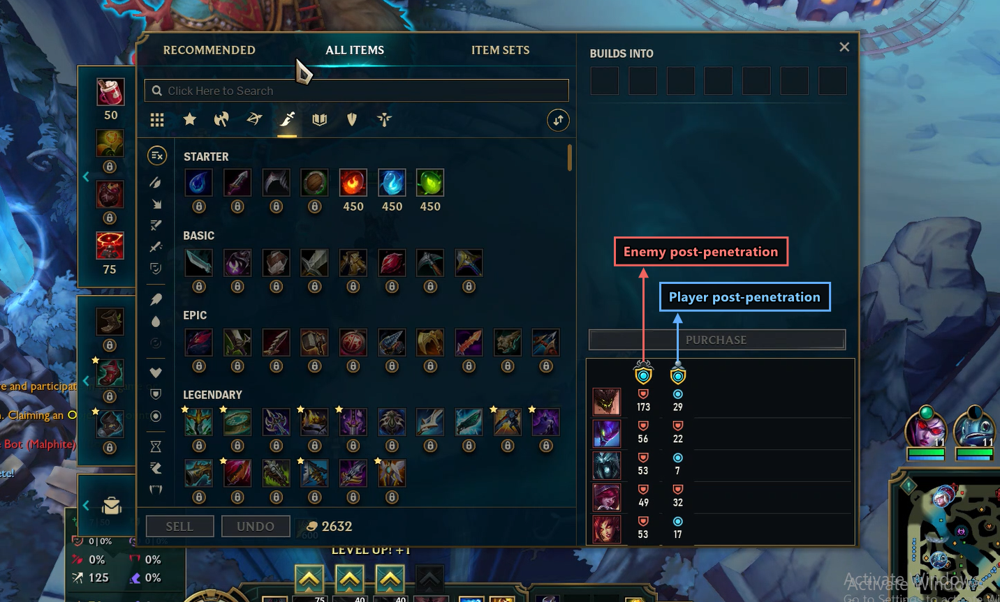
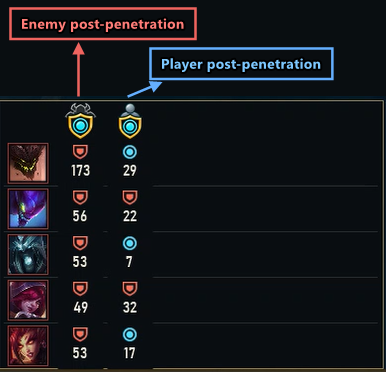
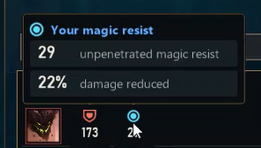
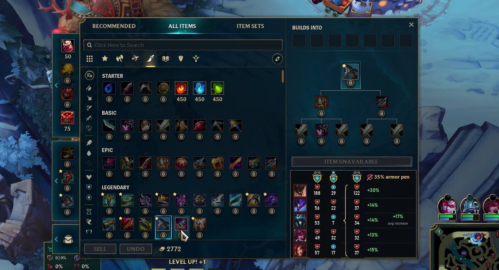
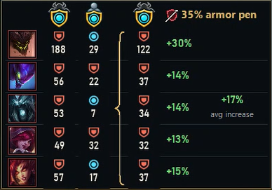
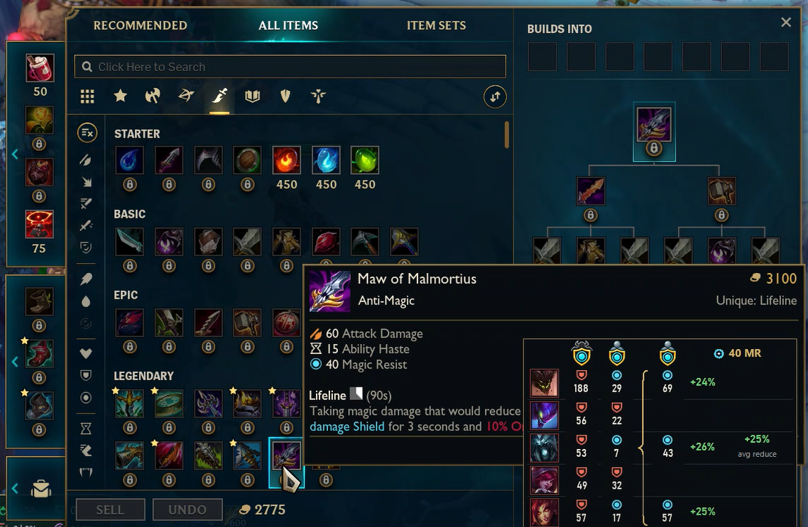

# Pen Lens

League of Legends overlay calculating damage gain/reduce per enemy from penetration and defense items.

### Post penetration per enemy

  
  

Hover to see damage reduce

### Damage gain from penetration item

  
  

### Defense gain from magic resist item

> **Note:** values are estimated from each champion's level and items only. Runes, buffs, stacks and some passives are not included, so the numbers are approximate.

## How it works

- Uses only the game's local Live Client Data API and Data Dragon. No Riot API key.
- Read-only: no memory reading, no code injection, no input sent to the game.
- Screen capture only of the shop area, to recognise the selected item.

## Legal

Pen Lens isn't endorsed by Riot Games and doesn't reflect the views or opinions of Riot Games or anyone officially involved in producing or managing Riot Games properties. Riot Games, and all associated properties are trademarks or registered trademarks of Riot Games, Inc.

The source code is not public. All rights reserved.