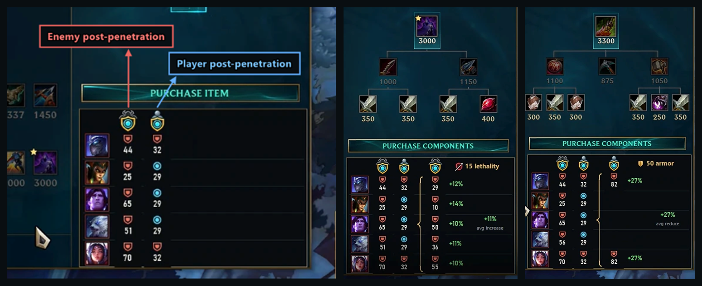
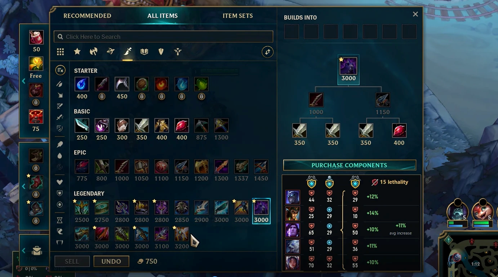
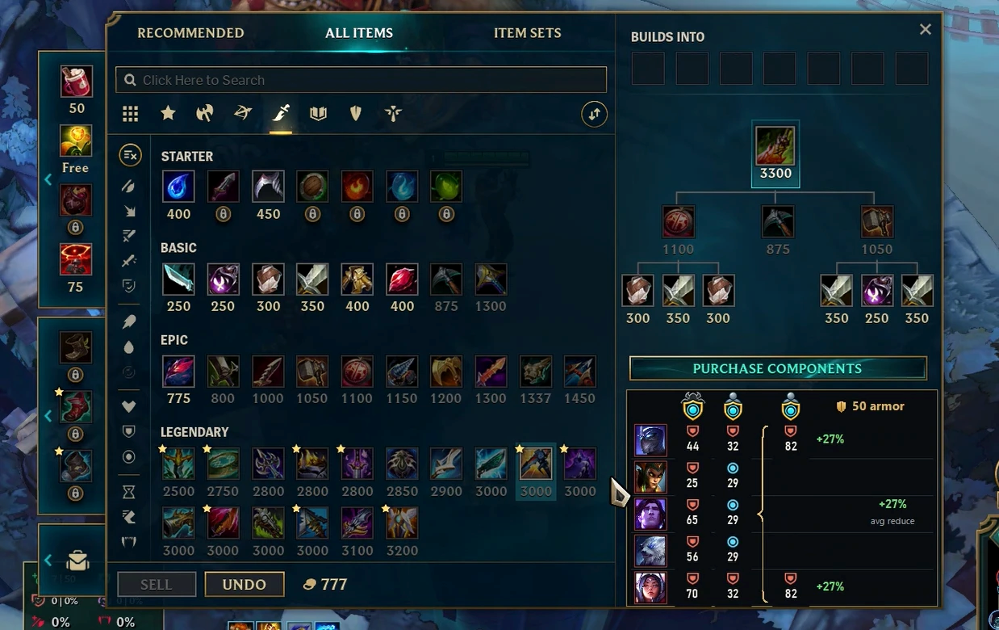

# Resist Lens

A free overlay for League of Legends that shows, inside the shop, how much damage each enemy actually blocks - and how much a selected item would change that.

*Left: the enemy panel. Middle: a lethality item selected. Right: an armor item selected.*

## The problem

Knowing how much of your damage gets through is hard to work out mid-game:

- Penetration comes as both flat and % values, and they stack in a specific order.
- Every enemy has different armor and magic resist, and to see them you have to move the camera to that champion and click on them - only if they are even visible.
- Damage reduction is non-linear, so even with the numbers it is hard to tell what going from 48 to 30 armor really means.

Experienced players estimate this from memory. Newer players usually have no idea, so choices like lethality vs. % armor penetration, or armor vs. magic resist, become guesswork.

## What it does

While the shop is open, a panel over the item description lists every enemy, in scoreboard order:

| Column | Meaning |
|---|---|
| Enemy post-penetration | The enemy's armor or magic resist after **your** penetration |
| Player post-penetration | **Your** armor or magic resist after that enemy's penetration |

Each value shows the stat that matters for the matchup: armor if the damage is physical, magic resist if it is magic.

When you select an item with penetration, armor or magic resist, the panel adds:

- the value after buying it, for every enemy it affects,
- the resulting change in damage for that enemy (e.g. **+14%** more of your damage gets through, or **+27%** less of theirs reaches you),
- the average change across the enemy team.

Hovering a value shows the unpenetrated stat and the % of damage it blocks.

It only shows numbers. It never recommends, ranks or highlights an item - the player decides.

## Screenshots

| Lethality item | Armor item |
|---|---|
|  |  |

## How it works

- **Data:** the local Live Client Data API that the game provides during a match (items, levels, your own stats), and Data Dragon (champion base stats, item stats and icons). It does not use the Riot Games API and needs no API key.
- **Read-only:** it does not read or modify game memory, inject code, or send any input to the game.
- **Screen capture** is limited to the shop area, only to recognise which item is selected (by matching its icon) and where the shop window is.
- Runs as a separate window on top of the game, in Borderless window mode.
- Free. No ads, no accounts, no data sent anywhere.

## Limitations

- Enemy stats are calculated from champion level and items. Bonuses that the game does not expose (stacking runes, buffs, dragons, some passives) are not included, so values can be slightly off.
- Works in Borderless window mode, not exclusive Fullscreen.
- Tested at 1920x1080.

## Status

In development. Not yet released - waiting for review by Riot Games.

## Legal

Resist Lens isn't endorsed by Riot Games and doesn't reflect the views or opinions of Riot Games or anyone officially involved in producing or managing Riot Games properties. Riot Games, and all associated properties are trademarks or registered trademarks of Riot Games, Inc.

The source code is not public. All rights reserved.
